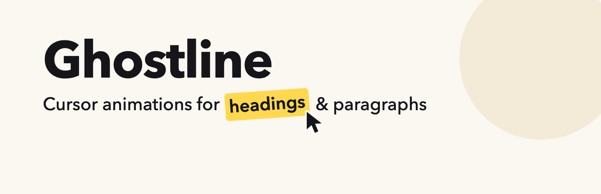
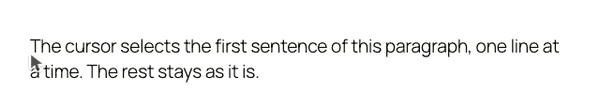
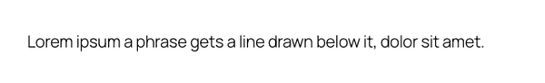

# Ghostline

A WordPress plugin. A fake cursor moves, marks, or types the text that you select, when the text scrolls into view. The motion reverses when you scroll back.

## Demo

[](https://youtu.be/XgIgxSXQCXU)

## Motions

| Motion | What the cursor does | Preview |
|---|---|---|
| Move | Drags tilted text into its position |  |
| Highlight | Selects the text; the highlight stays |  |
| Underline | Draws a line below the text |  |
| Strike | Draws a line through the text |  |
| Click | Clicks the text; a ring spreads out |  |
| Type | Types the text, one character at a time |  |
| Circle | Draws a ring around the text |  |
| Box | Draws a box around the text |  |
| Replace | Strikes out old text, then types the new text |  |

## Requirements

- WordPress 6.5 or later
- PHP 8.1 or later

## Installation

### From WordPress.org

- In WP Admin, go to **Plugins → Add New**, search for "Ghostline", then click **Install Now**.
- Or download the zip from [wordpress.org/plugins/ghostline](https://wordpress.org/plugins/ghostline/), then upload it in **Plugins → Add New → Upload Plugin**.

### With Composer

Add the [WP Packages](https://wp-packages.org) repository to your `composer.json`:

```json
{
	"repositories": [
		{
			"type": "composer",
			"url": "https://repo.wp-packages.org",
			"only": [ "wp-plugin/*", "wp-theme/*" ]
		}
	]
}
```

Then require the plugin:

```sh
composer require wp-plugin/ghostline
```

The package uses `composer/installers`. Composer asks you to allow it, and installs the plugin into `wp-content/plugins/ghostline/`. To use another folder, set `installer-paths` in `extra`.

## Usage

1. Activate the plugin.
2. In the block editor, select some text in a Heading, Paragraph, List, or Quote block.
3. In the block toolbar, open **More** (the arrow) and click **Ghostline**.
4. Set the options in the popover.

## Contributing

See [CONTRIBUTING.md](CONTRIBUTING.md).

## License

GPL-2.0-or-later
